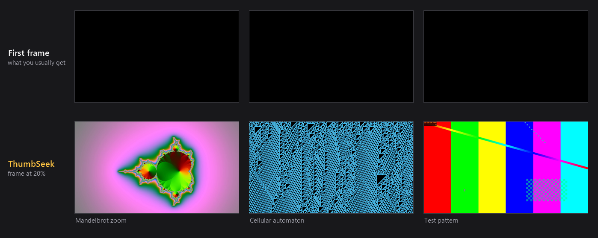
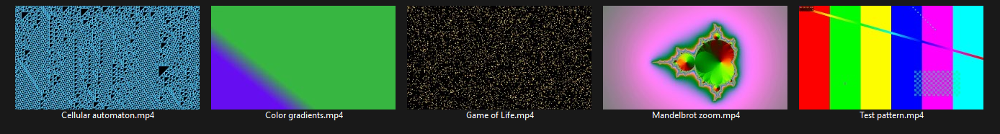
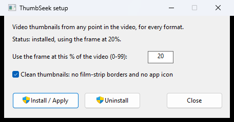

<h1 align="center">ThumbSeek</h1>

  <b>Windows Explorer video thumbnails from any point you choose in the video, not the first frame.</b> 
  Every format · fast · works in folder previews

  
  
  
  

Lots of videos start with a black screen, a logo or a title card, so Explorer's thumbnails all look the same.
ThumbSeek shows the frame from a point you pick instead, for example 20% into the video:

## Features

- **Pick the point:** any percentage from 0 to 99 (default 25).
- **Every format:** mp4, mkv, webm, avi, wmv, ts, flv, mpg, vob, rmvb and more, decoded with [FFmpeg](https://ffmpeg.org).
- **Fast:** decodes a single keyframe and scales it straight into the thumbnail, typically 15–300 ms even for multi-GB files.
- **Folder previews too:** folder icons show the chosen frames of the videos inside.
- **Clean thumbnails (optional):** removes the film-strip borders and the app icon Explorer draws on video thumbnails.

## Install

1. [Download the latest release](https://github.com/shad0w-xx/ThumbSeek/releases/latest) and extract it into one folder.
2. Run `ThumbSeek-setup.exe`, enter the percentage (0-99) and click **Install / Apply** (asks for admin rights).
   Run it again any time to change the percentage.

Setup copies the files to `C:\Program Files\ThumbSeek`, registers the handler, restarts Explorer and clears the thumbnail cache.
To remove it, run `ThumbSeek-setup.exe` and click **Uninstall**: Windows' own video thumbnails come back.

## What it changes on your system

Install / Apply (needs admin rights):

- Copies `ThumbSeek.dll` and the five FFmpeg DLLs it needs into `C:\Program Files\ThumbSeek`.
- Registers `ThumbSeek.dll` as the Explorer thumbnail handler (a COM shell extension) for these video types:
  .mp4 .m4v .mov .mkv .webm .wmv .asf .avi .divx .ts .m2ts .mts .m2t .3gp .3g2 .flv .f4v .mpg .mpeg .mpe .m2v .vob .rm .rmvb .ogv .ogm .mxf .dv.
  The handler each type had before (normally Windows' own) is saved and restored on uninstall.
- Sets `DisableProcessIsolation` for the handler, so it runs inside Explorer instead of Windows' isolated thumbnail
  process (which is far too slow for large videos).
- Stores the chosen percentage as `Percent` under the handler's registry key.
- If "Clean thumbnails" is ticked: sets `Treatment` to 0 and an empty `TypeOverlay` under
  `HKLM\Software\Classes\SystemFileAssociations\video`, which removes the film-strip borders and the app icon Explorer
  draws on all video thumbnails. Unticked, it restores Windows' default.
- Restarts Explorer and deletes the current user's thumbnail cache, so thumbnails are regenerated.
- Removes a copy installed under the old name (`C:\Program Files\thumb25`), if present.

Uninstall reverses all of this: restores the previous thumbnail handlers and Windows' default film-strip/app-icon
setting, removes the handler registration and `C:\Program Files\ThumbSeek`, restarts Explorer and clears the cache.

## Build

Requires Visual Studio Build Tools (C++ workload) and the FFmpeg `lgpl-shared` win64 build from
[FFmpeg-Builds](https://github.com/BtbN/FFmpeg-Builds) extracted into `ffmpeg_dl\`. Then run `build.cmd`.
The CI workflow in `.github/workflows/build.yml` does exactly this.

## Code signing policy

Free code signing provided by [SignPath.io](https://about.signpath.io), certificate by [SignPath Foundation](https://signpath.org) (application pending).

- Committers and reviewers: [@shad0w-xx](https://github.com/shad0w-xx)
- Approvers: [@shad0w-xx](https://github.com/shad0w-xx)

Only `ThumbSeek.dll` and `ThumbSeek-setup.exe` are built from this repository and signed. The FFmpeg DLLs are
unmodified upstream binaries from FFmpeg-Builds and are shipped unsigned.

## Privacy

This program will not transfer any information to other networked systems unless specifically requested by the
user or the person installing or operating it.

## License

ThumbSeek is MIT licensed. FFmpeg is licensed under the LGPL; its license is included in releases as `FFMPEG-LICENSE.txt`,
and its source code is available from [ffmpeg.org](https://ffmpeg.org) and [FFmpeg-Builds](https://github.com/BtbN/FFmpeg-Builds).
